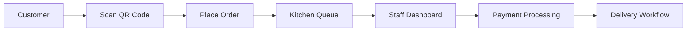
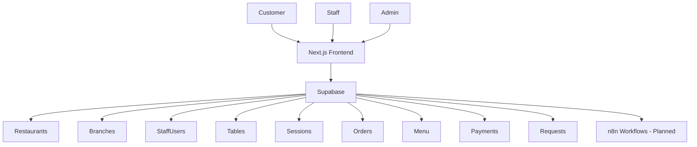

<div align="center">

# 🍽️ ServeFlow

### Restaurant Operations & Delivery Automation Platform

Automating restaurant workflows from customer orders to delivery fulfillment.


</div>

---

## Table of Contents

- [Overview](#overview)
- [The Problem](#the-problem)
- [The Solution](#the-solution)
- [How It Works](#how-it-works)
- [Features](#features)
- [Architecture](#architecture)
- [Tech Stack](#tech-stack)
- [Database Modules](#database-modules)
- [Project Structure](#project-structure)
- [Getting Started](#getting-started)
- [Environment Variables](#environment-variables)
- [Database Setup](#database-setup)
- [Development Workflow](#development-workflow)
- [Roadmap](#roadmap)
- [Screenshots](#screenshots)
- [Vision](#vision)
- [Contributing](#contributing)
- [License](#license)

---

# Overview

ServeFlow is a restaurant operations platform designed to streamline customer ordering, table management, service requests, payments, and local delivery workflows.

The goal is to help restaurants reduce operational friction, improve customer experience, and automate repetitive tasks through a centralized system.

---

# The Problem

Many restaurants still rely on fragmented processes.

Common challenges include:

- Missed customer calls during peak hours
- Slow table service
- Manual order tracking
- Lack of delivery workflow management
- Inefficient communication between staff
- Limited operational visibility

Small and medium-sized restaurants often cannot afford enterprise-grade restaurant management solutions.

---

# The Solution

ServeFlow provides a unified platform that connects customers, staff, and restaurant management through a single system.

Customers can:

- Place orders digitally
- Request assistance
- Track order status

Restaurant staff can:

- Manage tables
- Handle service requests
- Monitor active orders

Restaurant owners can:

- Track restaurant operations
- Monitor performance
- Manage branches and staff

---

# How It Works



---

# Features

<details>
<summary><strong>🍽️ Dine-In Operations</strong></summary>

- QR-based ordering
- Table management
- Session tracking
- Order lifecycle management
- Real-time status updates

</details>

<details>
<summary><strong>🧑‍🍳 Restaurant Operations</strong></summary>

- Multi-branch support
- Staff management
- Table assignment
- Service request handling
- Restaurant administration

</details>

<details>
<summary><strong>🚚 Delivery Automation</strong></summary>

- Delivery request management
- Delivery status tracking
- Order fulfillment workflow
- Local delivery support

</details>

<details>
<summary><strong>💳 Payments</strong></summary>

- Cash payments
- Card payments
- UPI payments
- Payment status tracking

</details>

<details>
<summary><strong>📊 Analytics & Insights (Planned)</strong></summary>

- Revenue analytics
- Operational dashboards
- Order insights
- Performance tracking

</details>

---

# Architecture



---

# Tech Stack

| Layer | Technology |
|---------|------------|
| Frontend | Next.js 16 |
| Language | TypeScript |
| Styling | Tailwind CSS |
| Database | PostgreSQL |
| Backend Platform | Supabase |
| Authentication | Supabase Auth |
| Workflow Automation | n8n (Planned) |
| Deployment | Vercel |
| Version Control | Git + GitHub |

---

# Database Modules

Current database design includes:

### Core Business

- Restaurants
- Branches

### User Management

- Staff Users
- Role Management

### Restaurant Operations

- Restaurant Tables
- Table Sessions

### Ordering

- Menu Categories
- Menu Items
- Orders

### Service Layer

- Service Requests
- Request Tracking

### Payments

- Payment Records
- Payment Methods
- Payment Status Tracking

---

# Project Structure

```text
serveflow/
│
├── frontend/
│   ├── src/
│   ├── public/
│   ├── package.json
│   └── next.config.ts
│
├── database/
│   └── sql/
│       ├── 001_extensions.sql
│       ├── 002_enums.sql
│       ├── 003_restaurant_core_tables.sql
│       ├── 004_branches.sql
│       ├── 005_users.sql
│       ├── 006_tables.sql
│       ├── 007_table_sessions.sql
│       ├── 008_menu.sql
│       ├── 009_orders.sql
│       ├── 010_service_requests.sql
│       └── 011_payments.sql
│
├── docs/
│
├── .github/
│
└── README.md
```

---

# Getting Started

### Clone Repository

```bash
git clone https://github.com/absksync/serveflow.git

cd serveflow
```

### Install Dependencies

```bash
cd frontend

npm install
```

### Start Development Server

```bash
npm run dev
```

Application runs at:

```text
http://localhost:3000
```

---

# Environment Variables

Create:

```text
frontend/.env.local
```

Add:

```env
NEXT_PUBLIC_SUPABASE_URL=your_supabase_url

NEXT_PUBLIC_SUPABASE_ANON_KEY=your_supabase_anon_key
```

---

# Database Setup

Open Supabase SQL Editor and execute scripts sequentially:

```text
001_extensions.sql
002_enums.sql
003_restaurant_core_tables.sql
004_branches.sql
005_users.sql
006_tables.sql
007_table_sessions.sql
008_menu.sql
009_orders.sql
010_service_requests.sql
011_payments.sql
```

This will create the core database schema required for ServeFlow.

---

# Development Workflow

ServeFlow follows a startup-style Git workflow.

```text
main
│
develop
│
feature/*
```

### Create Feature Branch

```bash
git checkout develop

git pull origin develop

git checkout -b feature/order-management
```

### Commit Changes

```bash
git add .

git commit -m "feat: implement order management module"
```

### Push Branch

```bash
git push origin feature/order-management
```

### Open Pull Request

```text
feature/* → develop

develop → main
```

---

# Current Progress

### Project Foundation

- [x] Repository Setup
- [x] Git Workflow Setup
- [x] Next.js Frontend Setup
- [x] Supabase Integration
- [x] Database Schema Design

### Core Modules

- [x] Restaurants
- [x] Branches
- [x] Users
- [x] Tables
- [x] Sessions
- [x] Menu
- [x] Orders
- [x] Service Requests
- [x] Payments

### In Development

- [ ] Authentication
- [ ] Dashboard UI
- [ ] Order Management Interface
- [ ] Table Management Interface

---

# Roadmap

## Phase 1 — MVP

- [ ] Authentication
- [ ] Restaurant Dashboard
- [ ] Table Management
- [ ] Order Tracking
- [ ] Payment Management

## Phase 2 — Operations

- [ ] Kitchen Dashboard
- [ ] Service Request System
- [ ] Multi-Branch Management
- [ ] Staff Permissions

## Phase 3 — Delivery Automation

- [ ] Delivery Workflows
- [ ] Driver Assignment
- [ ] Customer Notifications
- [ ] Delivery Tracking

## Phase 4 — Intelligence Layer

- [ ] Analytics Dashboard
- [ ] Demand Forecasting
- [ ] Revenue Insights
- [ ] Operational Recommendations

---

# Screenshots

Coming Soon

Future screenshots:

- Dashboard
- Order Management
- Table Management
- Payment Flow
- Delivery Workflow

---

# Vision

ServeFlow aims to become a complete operating system for independent restaurants.

By combining restaurant operations, customer experience, payment management, and delivery automation into a unified platform, ServeFlow seeks to provide restaurants with enterprise-level capabilities without enterprise-level complexity.

---

# Contributing

Contributions, suggestions, and feedback are welcome.

### Fork Repository

```bash
git fork
```

### Create Feature Branch

```bash
git checkout -b feature/new-feature
```

### Commit Changes

```bash
git commit -m "feat: add new feature"
```

### Push Changes

```bash
git push origin feature/new-feature
```

### Open Pull Request

Submit a pull request for review.

---

# License

MIT License

Feel free to use, modify, and distribute this project according to the terms of the license.

---

<div align="center">

Built with ☕, TypeScript, and many late-night debugging sessions.

</div>
